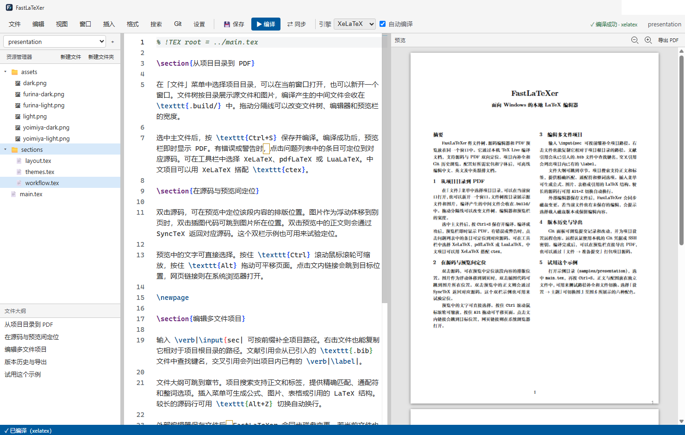
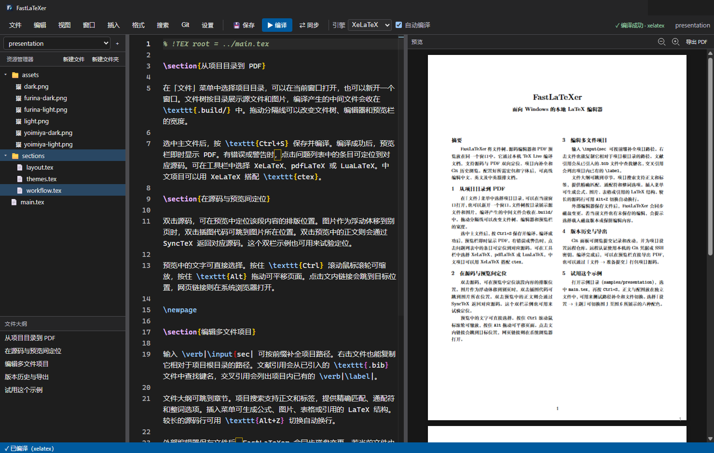
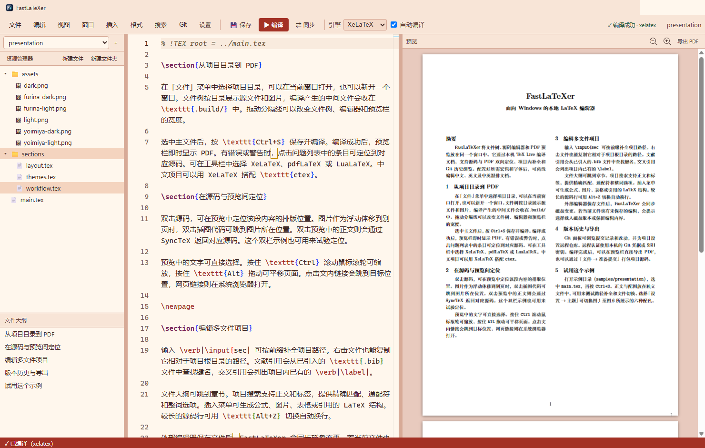
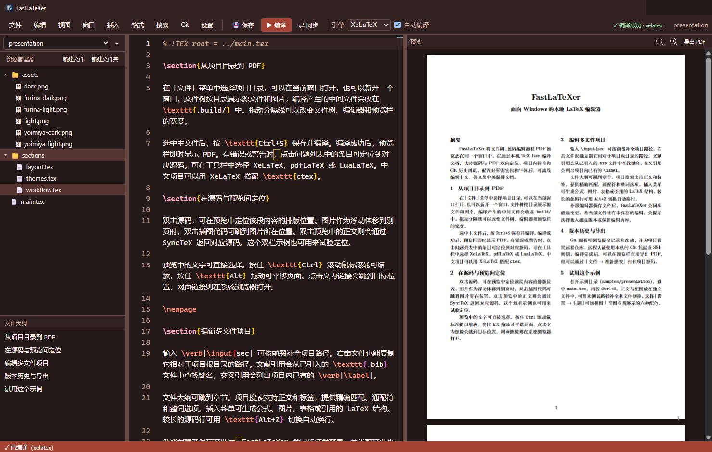
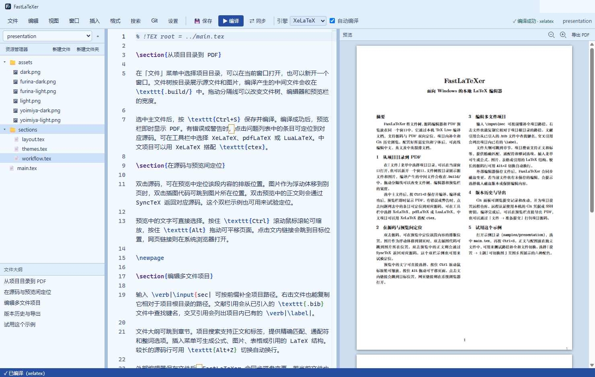
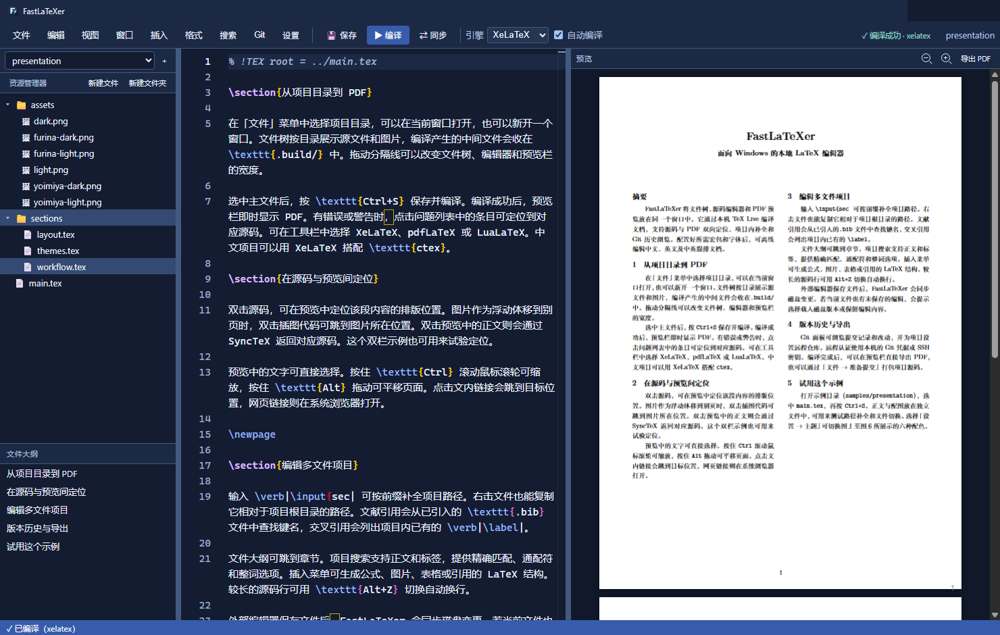

# FastLaTeXer


FastLaTeXer 是一款面向 Windows 的本地 LaTeX 桌面编辑器。文件树、源码编辑器和 PDF 预览同屏显示，适合在同一窗口中编写、编译和检查多文件 LaTeX 项目。

## 项目特点

- **本机编译，离线写作**。项目文件保存在本机，编译调用已安装的 TeX Live，支持 XeLaTeX、pdfLaTeX 和 LuaLaTeX。配置好文档所需的宏包和字体后，可以离线编译英文、中文和中英混排文档。
- **源码、PDF 和诊断联动**。按 `Ctrl+S` 保存并编译，生成的 PDF 在侧栏更新。通过 SyncTeX 可在源码和 PDF 之间双向跳转，也可以点击问题面板中的诊断定位源码。
- **适合多文件项目**。在 `\input{…}`、`\include{…}` 中可按前缀补全项目路径，文件大纲和标签搜索可直接跳到源码。项目可在独立窗口打开，Git 面板可查看提交历史和改动。
- **桌面安装与界面自定义**。提供 Windows x64 安装包，内置 Electron。界面支持中文和英文，提供常规浅色、深色与宵宫、芙宁娜两组主题，并记住上次使用的配色。

## 安装

以下步骤适用于 Windows x64，命令在 PowerShell 中执行。普通使用请选择安装包，修改 FastLaTeXer 代码时请选择源码安装。

### 两种方式共用的配置

安装包内置 Electron，可以直接打开编辑器。编译 LaTeX 和使用 Git 面板时，分别需要目标电脑上的 **TeX Live** 和 **Git**。

1. 安装 TeX Live，在 Windows「环境变量 → 用户变量 → Path」中添加实际的 TeX Live 可执行文件目录，例如 `C:\texlive\2026\bin\windows`。添加的是包含 `latexmk.exe` 的目录。若只想在当前 PowerShell 中测试，可暂时设置 `$env:Path = "C:\texlive\2026\bin\windows;$env:Path"`，并将示例路径换成实际路径。
2. 使用 Git 面板时，把 Git 的 `cmd` 目录也加入用户 `Path`，例如 `C:\Program Files\Git\cmd`。使用远程仓库时，沿用本机配置的 Git 凭据或 SSH 密钥。
3. 修改用户 `Path` 后，重新打开 PowerShell 和 FastLaTeXer。若从桌面快捷方式启动后仍读到旧的 `Path`，注销并重新登录 Windows。

```powershell
Get-Command latexmk, xelatex, pdflatex, lualatex, synctex -ErrorAction SilentlyContinue |
  Select-Object Name, Source
latexmk -v
xelatex --version
git --version   # 仅使用 Git 面板时需要
```

默认编译用到 `latexmk` 和 `xelatex`，双向跳转用到 `synctex`。选择 pdfLaTeX 或 LuaLaTeX 时，需分别能运行 `pdflatex` 或 `lualatex`。编译中文时，TeX Live 还应包含文档所需的 `ctex` 和字体。

### 方式一：用安装包安装

1. 取得 `FastLaTeXer-Setup-<版本>-x64.exe`。在本仓库自行构建的安装包位于 `release/`，例如 `release/FastLaTeXer-Setup-0.1.0-x64.exe`。
2. 双击安装包，选择为当前用户安装。首次安装时，可在「选择安装位置」页面用「浏览」指定目录。默认目录为 `%LOCALAPPDATA%\Programs\FastLaTeXer`。覆盖升级通常沿用已有目录并跳过这一步，静默安装也不会显示向导。安装包自带 Electron，无需安装 Node.js 或 npm。
3. 从桌面或开始菜单启动，或者双击安装目录中的 `FastLaTeXer.exe`。卸载时运行同一目录中的 `uninstall.exe`。

NSIS 安装程序需要能写入 `TEMP` 和 `TMP` 指向的临时目录。它们通常指向 `%LOCALAPPDATA%\Temp`。若出现 **Error writing temporary file**，可在仓库根目录执行下面的命令。命令将安装包复制到用户的本地应用数据目录，并仅为这次安装指定临时目录，退出后恢复当前 PowerShell 中的原值。

```powershell
$source = (Resolve-Path '.\release\FastLaTeXer-Setup-0.1.0-x64.exe').Path
$stage = Join-Path $env:LOCALAPPDATA 'FastLaTeXer\Setup'
$setupTemp = Join-Path $stage 'Temp'
$setup = Join-Path $stage (Split-Path $source -Leaf)
New-Item -ItemType Directory -Path $setupTemp -Force | Out-Null
Copy-Item -LiteralPath $source -Destination $setup -Force
if ((Get-FileHash $source).Hash -ne (Get-FileHash $setup).Hash) { throw '安装包副本校验失败。' }

$oldTemp, $oldTmp = $env:TEMP, $env:TMP
try {
  $env:TEMP = $setupTemp
  $env:TMP = $setupTemp
  $installer = Start-Process -FilePath $setup -WorkingDirectory $stage -Wait -PassThru
  if ($installer.ExitCode -ne 0) { throw "安装程序退出码为 $($installer.ExitCode)。" }
} finally {
  $env:TEMP = $oldTemp
  $env:TMP = $oldTmp
}
```

如果安装包不在 `release/` 中，或版本不同，请将第一行的路径换成实际安装包路径。

### 方式二：从源码安装和运行

安装 [Node.js](https://nodejs.org/) **22.12.0 或更高版本**（含 npm），确保 Node.js 安装目录已加入 `Path`。在包含 `package.json` 和 `package-lock.json` 的仓库根目录执行：

```powershell
node --version
npm.cmd --version
npm.cmd ci
npm.cmd run typecheck
npm.cmd run dev
```

开发命令会启动 Vite 和 Electron。开发服务固定在 `127.0.0.1:5173`，启动前可用 `Get-NetTCPConnection -LocalPort 5173 -State Listen -ErrorAction SilentlyContinue` 检查端口是否被其他程序占用。要从构建产物启动，可在同一目录执行：

```powershell
npm.cmd run build
npm.cmd start
```

| 环境变量 | 用途与配置 |
| --- | --- |
| `Path` | 源码模式需要能找到 `node.exe` 和 `npm.cmd`。两种安装方式都通过它查找 TeX Live 和 Git。 |
| `VITE_DEV_SERVER_URL` | `npm.cmd run dev` 会给 Electron 子进程设置 `http://127.0.0.1:5173`。运行 `npm.cmd start` 时应保持未设置，以加载 `dist/index.html`。 |
| `ELECTRON_OVERRIDE_DIST_PATH` | 可选，指向包含 `electron.exe` 的目录。仅在默认 Electron 运行时无法启动时使用，运行时版本和架构应与项目依赖一致。 |
| `ELECTRON_MIRROR` | 可选，用于 Electron 运行时下载，例如 `$env:ELECTRON_MIRROR = 'https://npmmirror.com/mirrors/electron/'`。只有默认下载源不可用时才需要设置。 |
| `TEMP`、`TMP` | 指向当前用户可写的目录。安装程序使用它们解包，源码打包脚本也会在系统临时目录中生成中间文件。 |

Windows 上也可以双击 `scripts/start-dev.cmd` 启动开发版。若 `%LOCALAPPDATA%\FastLaTeXer\electron-<版本>\electron.exe` 已存在，脚本会优先使用这个与项目依赖版本匹配的 Electron 副本，也会保留手动指定的 `ELECTRON_OVERRIDE_DIST_PATH`。

### 从源码生成 Windows 安装包

```powershell
npm.cmd ci
npm.cmd run package:win
```

打包会构建渲染层，在可写的系统临时目录中生成 NSIS 安装程序，然后把成品复制到 `release/`。首次构建需要下载 Electron 和 NSIS 工具。若构建工具的默认下载源不可用，可在当前 PowerShell 设置 `$env:ELECTRON_BUILDER_BINARIES_MIRROR = 'https://npmmirror.com/mirrors/electron-builder-binaries/'` 后重试。

### 可直接交给 Agent 的安装指令

```text
请在这台 Windows x64 电脑上安装并验证 FastLaTeXer。先阅读当前仓库的 README.md「安装」章节。

目标方式：安装包安装。若我指定“源码开发”，则改用源码模式。

1. 检查 Windows 架构、TEMP 和 TMP 指向的目录及其写权限，检查 Path 中的 latexmk、xelatex 和 synctex。需要 Git 面板时再检查 Git。源码模式额外检查 Node.js ≥ 22.12.0 和 npm。
2. 安装包模式优先使用仓库 release/ 中的 x64 安装程序。若已存在正式安装，先确认版本和路径，避免覆盖未授权的安装。安装时使用当前用户范围。遇到 NSIS 临时文件错误时，按 README 把安装包复制到 LOCALAPPDATA 下，核对 SHA-256，仅给这次安装指定可写的 TEMP 和 TMP。
3. 源码模式从仓库根目录运行 npm.cmd ci、npm.cmd run typecheck 和 npm.cmd run dev。检查 127.0.0.1:5173 的占用情况；如果端口被别的程序占用，报告进程，保留其运行状态。默认 Electron 无法启动时，再检查是否有与依赖版本和架构一致的运行时可用于 ELECTRON_OVERRIDE_DIST_PATH。
4. 启动应用并确认窗口加载。若 TeX Live 可用，用 samples/demo 的临时副本编译，检查 PDF 预览。安装包模式还要确认安装目录里有 FastLaTeXer.exe 和 uninstall.exe，并报告安装位置、测试结果及缺失依赖。
5. 使用进程级环境变量进行诊断。仅在确定需要长期配置时才添加已核实的目录到用户 Path，并保留已有条目。保留项目文件，记录实际做过的改动。
```

## 首次打开项目

启动后从 **「文件 → 打开项目文件夹」** 选择打开方式，再选择 LaTeX 项目目录。可先打开仓库内的 `samples/demo` 体验完整流程。

打开 [`samples/presentation`](samples/presentation/)，选中 `main.tex` 并按 `Ctrl+S`，即可编译竖版 A4 双栏产品介绍。示例使用 XeLaTeX、`ctex` 和 TeX Live 提供的 Fandol 字体。从仓库根目录执行以下命令也可编译。

```powershell
Set-Location .\samples\presentation
latexmk -xelatex -outdir=.build main.tex
```

打开项目文件夹时可选择在当前窗口打开或在新窗口打开。新窗口拥有独立的项目、编辑器和预览。

开发模式中，保存 `src/` 下的界面改动后，Vite 会自动更新窗口。修改 `electron/` 下的主进程或预加载代码后，关闭所有开发窗口并重新启动。

## 个性化配置

### 在应用内切换

- 顶部「设置」可以切换中文或英文界面，也可选择常规浅色、深色及宵宫、芙宁娜的浅色和深色主题。编辑器、工具栏和窗口标题栏会一起换色，应用会在下次启动时恢复上次使用的主题。
- 顶部工具栏可以切换 LaTeX 引擎和输入后自动编译。若希望某份文档始终使用指定引擎，可在主 `.tex` 文件开头添加 `% !TEX program = xelatex`，也可改用 `pdflatex` 或 `lualatex`。

### 界面预览

六张截图都来自同一个项目，展示文件树与大纲、LaTeX 源码高亮，以及编译后的 PDF 预览。点击截图可查看原图。

| 浅色                                                         | 深色                                                         |
| ------------------------------------------------------------ | ------------------------------------------------------------ |
| **常规浅色**<br>[](samples/presentation/assets/light.png) | **常规深色**<br>[](samples/presentation/assets/dark.png) |
| **宵宫主题配色-浅色**<br>[](samples/presentation/assets/yoimiya-light.png) | **宵宫主题配色-深色**<br>[](samples/presentation/assets/yoimiya-dark.png) |
| **芙宁娜主题配色-浅色**<br>[](samples/presentation/assets/furina-light.png) | **芙宁娜主题配色-深色**<br>[](samples/presentation/assets/furina-dark.png) |

[查看 A4 双栏产品介绍 PDF](samples/presentation/FastLaTeXer.pdf) · [查看 LaTeX 示例源码](samples/presentation/)

### 从源码添加新主题

[`@themes/`](@themes/) 下每套主题各有一个 CSS 文件。工作区、Monaco 和 Electron 标题栏使用同一份配色，设置菜单的中英文名称记录在 [`catalog.json`](@themes/catalog.json)。

1. 复制一个现有主题，例如将 `furina-light.css` 复制为 `sea-salt.css`。把选择器改为 `:root[data-theme="sea-salt"]`，并将 `color-scheme` 设为 `light` 或 `dark`。
2. 修改 CSS 变量，颜色使用 `#RRGGBB`。`--bg` 和 `--fg` 控制编辑区背景和正文，`--bg2` 控制工具栏与标题栏背景。`--editor-*` 控制当前行、选区、光标和语法高亮。检查语法颜色在正文背景、当前行和选区上都易读。
3. 在 `catalog.json` 的 `themes` 中增加一个键名为 `sea-salt` 的条目，填写 `zh` 和 `en`。键名需与 CSS 文件名和选择器中的主题标识一致。
4. 运行 `npm.cmd run typecheck`，重新启动开发版后在「设置 → 主题」中选择新主题。若要让正式安装版包含新主题，运行 `npm.cmd run package:win`。

若只想更换编辑器字体或字号，可在 [`src/components/EditorPane.tsx`](src/components/EditorPane.tsx) 的 Monaco 初始化配置中调整 `fontFamily`、`fontSize` 和 `lineHeight`。

## 功能对照

| 需求 | 状态 |
| --- | --- |
| 打开项目文件夹 | ✅ 「文件 → 打开项目文件夹」/ `Ctrl+O` |
| 三栏布局（文件树 / 编辑器 / 预览） | ✅ 连接处可拖动调宽 |
| VS Code 风格工具栏 | ✅ 打开、保存、编译、同步、引擎选择、缩放、自动编译 |
| 文件树按层级展示 | ✅ 递归展开、当前文件高亮 |
| 高亮 LaTeX 编辑器 | ✅ Monaco + 自定义 LaTeX Monarch 高亮 |
| PDF 预览（含图片） | ✅ PDF.js 渲染，支持图片/公式 |
| 双向跳转（SyncTeX） | ✅ 双击预览→编辑器；工具栏「⇄ 同步」编辑器→预览 |
| 命令补全（`\includegraphics` 等） | ✅ 输入 `\` 触发，带参数占位符 |
| 环境自动闭合（`\begin{itemize}`→`\end{itemize}`） | ✅ 补全确认即生成，`\begin{` 触发环境列表 |
| itemize 内换行自动 `\item` | ✅ |
| 错误/警告显示与定位 | ✅ 底部问题面板 + 编辑器波浪线，点击跳转 |
| 包自动检测 / AI 调用 | ⏳ 预留接口，后续实现 |

## 快捷键

- `Ctrl+S` 保存并编译
- `Ctrl+Shift+S` 将当前文件另存为副本
- `Ctrl+O` 打开项目文件夹
- `Ctrl+Shift+B` 编译，`Ctrl+B` 加粗，`Ctrl+I` 斜体
- `Alt+Z` 切换编辑器自动换行，只改变显示方式。
- 在 PDF 预览中按住 `Ctrl` 并滚动鼠标滚轮缩放
- 双击编辑器中的 LaTeX 源码可定位到最近一次编译的 PDF。双击浮动图的代码时，会定位到图片实际排版的页面。
- PDF 预览默认可拖选文字，按住 `Alt` 再拖动页面。单击 PDF 链接可跳到文内目标或用系统浏览器打开网页，双击其他位置可跳回源码。
- `Ctrl+Shift+F` 搜索项目。可查找 `\label{...}` 或正文，支持完全匹配、`*` 和 `?` 通配符，以及整词匹配。
- 「⇄ 同步」→ 从当前光标定位到预览

在资源管理器中选中文件夹后，可在该目录下新建文件或文件夹。拖入外部文件时，落在文件夹行上会复制到该文件夹，落在文件行上会复制到该文件的同级目录，其他位置会复制到项目根目录。同名文件会保留原件。

在 `\input{…}` 或 `\include{…}` 的参数中输入前缀，可补全项目内的文件路径。右键文件也可直接复制项目相对路径，比如 `sections/abstract.tex`。

在 `\cite{…}` 中可补全通过 `\bibliography{…}` 或 `\addbibresource{…}` 引入的文献键。在 `\ref{…}`、`\eqref{…}` 等命令中可补全项目的 `\label{…}`。

编译后可从预览栏或「文件」菜单导出当前 PDF。「文件 → 打开最近项目」会保留最近打开的项目路径。

顶部 Git 面板可初始化仓库、配置 `origin`、获取历史和查看提交补丁。远程认证使用本机已配置的 Git 凭据或 SSH 密钥。「文件 → 准备提交」会生成本地 ZIP。

## 说明

在其他编辑器保存项目中的文件后，FastLaTeXer 会刷新文件树，并自动载入当前文件的磁盘版本。如果当前编辑区也有未保存修改，会保留编辑内容并提示选择「载入磁盘版本」或「保留编辑器版本」。选择保留后，可手动保存或先用「另存为」保存副本。

- 编译调用本机 `latexmk`（默认 **XeLaTeX**，支持中文/UTF-8），构建产物隔离在项目内 `.build/` 目录。
- 文件树会隐藏项目内的 LaTeX 中间产物，例如 `.aux`、`.log`、`.fls` 和 `.synctex.gz`。这些文件仍保存在磁盘上，可供编译和 SyncTeX 使用。
- 中文或中英混排文档可用 `\documentclass[UTF8]{ctexart}`，也可在现有文档类中加载 `ctex`。普通英文文档可继续使用 `article`、`report` 等文档类。
- 支持 `% !TEX program = xelatex` 魔法注释自动选择引擎。
- 错误/警告来自对 `.log` 的解析（`-file-line-error` 提供精确行号）。
- 自动编译默认开启（停止输入约 1 秒后触发，依赖 latexmk 增量缓存，速度很快）。

## 目录结构

```
electron/        主进程与预加载（文件系统、编译、SyncTeX）
@themes/         独立主题 CSS、主题目录与配色加载逻辑
src/             渲染层（React + Monaco + PDF.js）
  latex/         Monaco 配置、LaTeX 高亮、补全
  components/    UI 组件
scripts/         开发期验证脚本（日志解析、端到端编译/同步）
samples/demo/          基础 LaTeX 示例
samples/presentation/  双栏产品介绍的 LaTeX 源码、六套主题截图与 PDF
```
